<p align="center">
  
  
</p>

<h1 align="center">Instituto Tecnológico Nacional de México</h1>

<h2 align="center">Práctica recuperación</h2>

<p align="center">
<b>Alumno:</b><br>
Arellano Santos Jose Miguel<br><br>
<b>Materia:</b><br>
Administración de base de datos<br><br>
<b>Profesor:</b><br>
Diego Alberto Bollas Paredes
</p>

---

## Introducción

En esta práctica aprendí a recuperar una base de datos en MariaDB cuando se pierde información. Recuperar quiere decir regresar la base a como estaba antes de que pasara un problema, por ejemplo cuando alguien borra datos por error.

La práctica tiene dos partes. En la **Parte A** hice un respaldo de una base llamada `tienda`, la borré a propósito y la restauré con ese respaldo. En la **Parte B** activé el **binlog**, que es un registro donde MariaDB va guardando todos los cambios que se hacen. Con él pude recuperar también los datos que se agregaron *después* del respaldo, y que con el respaldo solo no se podían recuperar.

Todo lo hice desde la terminal de mi máquina virtual con Ubuntu (el servidor se llama `servidor-bd`), con el usuario `root` de MariaDB. Mi versión de MariaDB es la 10.3.39, por eso en los comandos uso `mysqldump` y `mysqlbinlog`, que en las versiones nuevas se llaman `mariadb-dump` y `mariadb-binlog`.

---

## Desarrollo

### Preparación

Primero creé una carpeta de trabajo para guardar todos los archivos de la práctica.

```bash
mkdir practica1 && cd practica1
mariadb -u root -p
```

En la captura se ve que entré a MariaDB y que la versión es la 10.3.39.

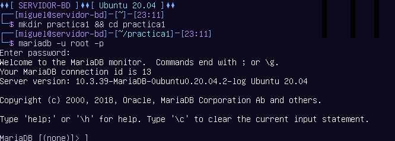

---

## Parte A: Respaldo y restauración

### Paso 1. Crear la base de datos y los datos

Entré a MariaDB y creé la base `tienda` con una tabla `clientes` (id, nombre y email). Después le agregué 5 clientes y conté cuántos registros había.

```sql
mariadb -u root -p

CREATE DATABASE tienda;
USE tienda;

CREATE TABLE clientes (
    id INT AUTO_INCREMENT PRIMARY KEY,
    nombre VARCHAR(100),
    email VARCHAR(100)
);

INSERT INTO clientes (nombre, email) VALUES
('ana torres', 'ana@correo.com'),
('luis perez', 'luis@correo.com'),
('maria gomez', 'maria@correo.com'),
('carlos ruiz', 'carlos@correo.com'),
('sofia diaz', 'sofia@correo.com');

SELECT COUNT(*) FROM clientes;
```

**Resultado:** la base y la tabla se crearon sin errores (`Query OK`). Después de insertar los 5 clientes, el conteo salió en **5**.

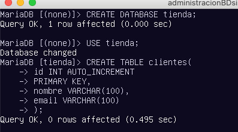

Salí de MariaDB con `EXIT;`.

### Paso 2. Hacer el respaldo

Con el comando `mysqldump` saqué un respaldo de la base `tienda` y lo guardé en un archivo llamado `tienda_backup.sql`. Luego revisé que el archivo sí se hubiera creado.

```bash
mysqldump -u root -p --databases tienda > tienda_backup.sql
ls -lh tienda_backup.sql
```

**Resultado:** el archivo `tienda_backup.sql` existe y pesa 2.4K, o sea que el respaldo se hizo bien.

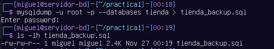

### Paso 3. Simular el desastre

Para simular que se perdió todo, borré la base `tienda` y después mostré la lista de bases de datos para comprobarlo.

```sql
mariadb -u root -p

DROP DATABASE tienda;
SHOW DATABASES;
```

**Resultado:** la base `tienda` ya no aparece en la lista; solo quedan las otras bases del servidor (`biblioteca`, `escuela`, `mysql`, etc.).

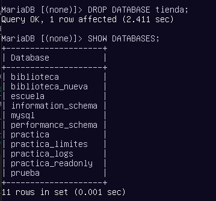

### Paso 4. Restaurar el respaldo

Para recuperar la base, metí el archivo del respaldo en MariaDB.

```bash
mariadb -u root -p < tienda_backup.sql
```

**Resultado:** no marcó ningún error. La captura de este paso está junto con la del Paso 5, porque las hice seguidas.

### Paso 5. Verificar la recuperación

Consulté la tabla `clientes` para ver si los datos habían regresado.

```bash
mariadb -u root -p -e "SELECT * FROM tienda.clientes;"
```

**Resultado:** aparecieron los **5 clientes**, así que la base se recuperó. Con esto terminé la Parte A.

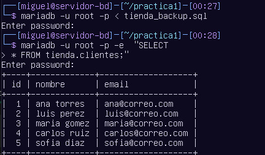

---

## Parte B: Recuperar los datos posteriores al respaldo con el binlog

Con el respaldo de la Parte A, todo lo que se guardara después del respaldo se habría perdido. Por eso en esta parte activé el binlog.

### Paso 1. Activar el binlog

Edité el archivo de configuración de MariaDB con `nano` y agregué dos líneas. En la práctica dice que van debajo de `[mariadbd]`, pero en mi versión (10.3.39) esa sección se llama `[mysqld]`, así que las puse ahí.

```bash
sudo nano /etc/mysql/mariadb.conf.d/50-server.cnf
```

```ini
[mysqld]
log_bin = /var/lib/mysql/mariadb-bin
server_id = 1
```

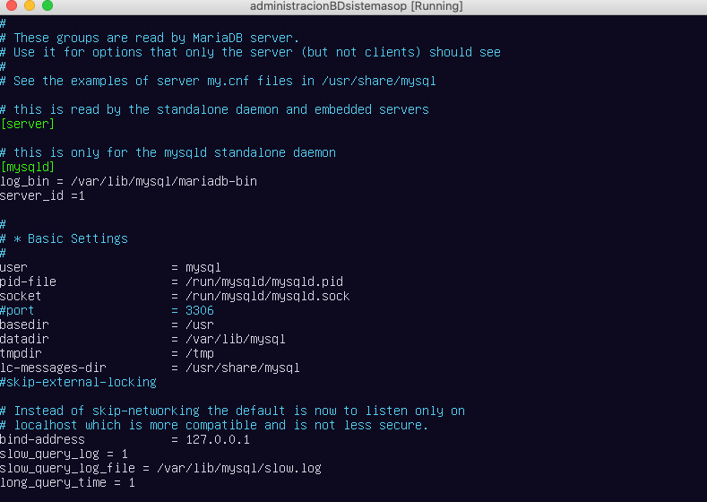

Guardé el archivo, reinicié MariaDB y revisé que el binlog estuviera activo.

```bash
sudo systemctl restart mariadb
mariadb -u root -p -e "SHOW VARIABLES LIKE 'log_bin';"
```

**Resultado:** `log_bin` aparece en **ON**, o sea que el binlog ya está funcionando.

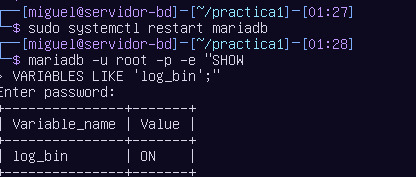

### Paso 2. Respaldo que guarda la posición del binlog

Hice otro respaldo, pero ahora con dos opciones nuevas: `--flush-logs`, que abre un archivo nuevo de binlog, y `--master-data=2`, que anota dentro del respaldo en qué archivo y en qué posición del binlog iba MariaDB. Después busqué esa línea con `grep`.

```bash
mysqldump -u root -p --databases tienda --flush-logs --master-data=2 > tienda_pitr.sql
grep "CHANGE MASTER" tienda_pitr.sql
```

**Resultado:** salió esta línea:

```
-- CHANGE MASTER TO MASTER_LOG_FILE='mysql-bin.000042', MASTER_LOG_POS=385;
```

Los datos que anoté fueron:
- **Archivo del binlog:** `mysql-bin.000042`
- **Posición:** `385`

Estos números son distintos a los del ejemplo de la práctica (que decía 330), así que tuve que usar los míos. Además, el archivo del binlog de mi servidor se llama `mysql-bin` y está en la carpeta `/var/log/mysql/`, no en la que puse yo en la configuración.

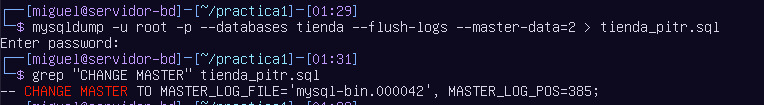

### Paso 3. Agregar datos nuevos (después del respaldo)

Agregué 2 clientes más, que ya no están en el respaldo que acabo de hacer, y conté los registros.

```sql
mariadb -u root -p

USE tienda;
INSERT INTO clientes (nombre, email) VALUES
('pedro nunez', 'pedro@correo.com'),
('laura vega', 'laura@correo.com');

SELECT COUNT(*) FROM clientes;
```

**Resultado:** ahora hay **7** clientes.

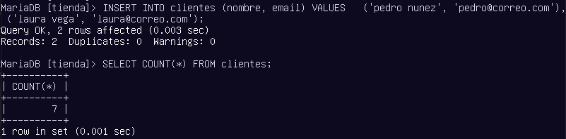

Esperé unos 5 segundos y consulté la hora del servidor:

```sql
SELECT NOW();
```

**Resultado:** la hora fue **2026-11-27 01:40:52**. La anoté porque la voy a necesitar después.

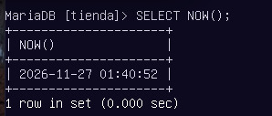

### Paso 4. Simular el error

Esperé otros 5 segundos y borré todos los clientes, como si hubiera sido un error.

```sql
DELETE FROM clientes;
SELECT COUNT(*) FROM clientes;
```

**Resultado:** se borraron los 7 registros y el conteo salió en **0**.

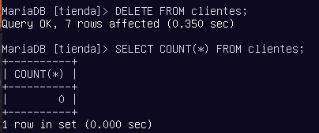

Salí de MariaDB con `EXIT;`.

### Paso 5. Restaurar el respaldo

Metí el respaldo `tienda_pitr.sql`. Con esto la tabla regresa, pero solo con los 5 clientes del respaldo; todavía faltan Pedro y Laura.

```bash
mariadb -u root -p < tienda_pitr.sql
```

### Paso 6. Aplicar el binlog hasta antes del error

Ahora hay que sacar del binlog los cambios que se hicieron después del respaldo y hasta antes del `DELETE`. Para eso se usa `mysqlbinlog` con la posición que anoté (385) y con la hora que anoté (01:40:52) como límite.

**Problemas que tuve.** Al principio me salieron errores. Primero usé la posición `330` (que es la del ejemplo de la práctica) y me salió el error *"Event truncated"*. Luego, al pasarle la contraseña con `sudo` y el símbolo `|`, me salió *"Access denied for user 'root'"*. Después probé con la posición `4` y no se recuperó nada, porque se siguieron viendo solo 5 clientes.

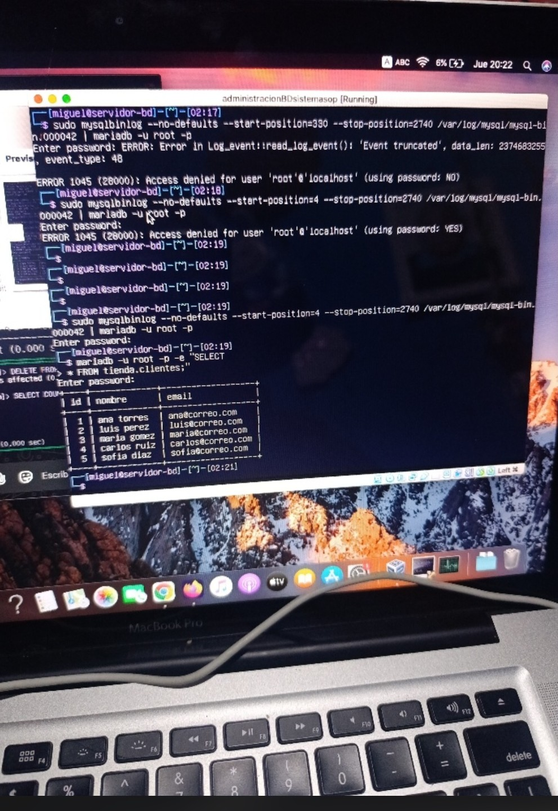

Para arreglarlo usé mi posición real (385) y lo hice en dos partes: primero guardé los cambios del binlog en un archivo (`recuperar.sql`) y luego metí ese archivo en MariaDB.

```bash
sudo mysqlbinlog --no-defaults --start-position=385 --stop-datetime="2026-11-27 01:40:52" /var/log/mysql/mysql-bin.000042 > recuperar.sql
mariadb -u root -p < recuperar.sql
```

### Paso 7. Verificar

Consulté la tabla para ver si ya estaban todos los clientes.

```bash
mariadb -u root -p -e "SELECT * FROM tienda.clientes;"
```

**Resultado:** aparecen los **7 clientes**, incluidos **Pedro Nunez** y **Laura Vega**. Se recuperó todo menos el `DELETE` que hice por error.


---

## Conclusiones

En esta práctica vi la diferencia entre un respaldo normal y la recuperación con el binlog. Con solo el respaldo pude recuperar la base, pero únicamente como estaba cuando hice la copia; los clientes que agregué después (Pedro y Laura) se habrían perdido. Con el binlog, pude volver a aplicar esos cambios y dejar la base como estaba justo antes del error.

También aprendí que hay que anotar bien el archivo, la posición y la hora, y que no se pueden copiar los números del ejemplo, porque cada servidor tiene los suyos. Eso fue lo que me causó los errores al principio. Y que el binlog hay que activarlo antes de que pase el problema, porque no sirve para cambios que ya pasaron sin que estuviera activo.

Me llevo que hacer respaldos seguido y tener el binlog activado es lo que permite recuperar casi todo cuando alguien se equivoca.
